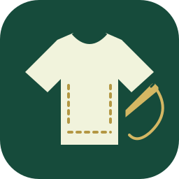
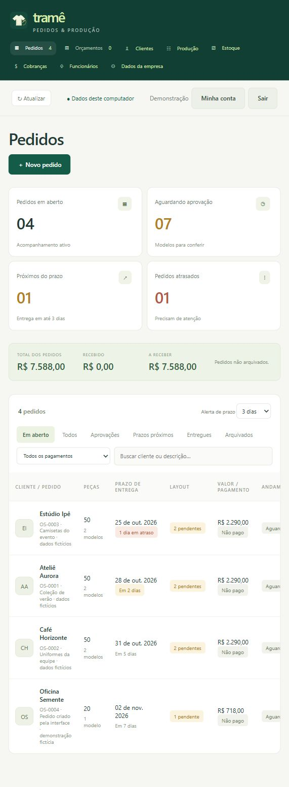
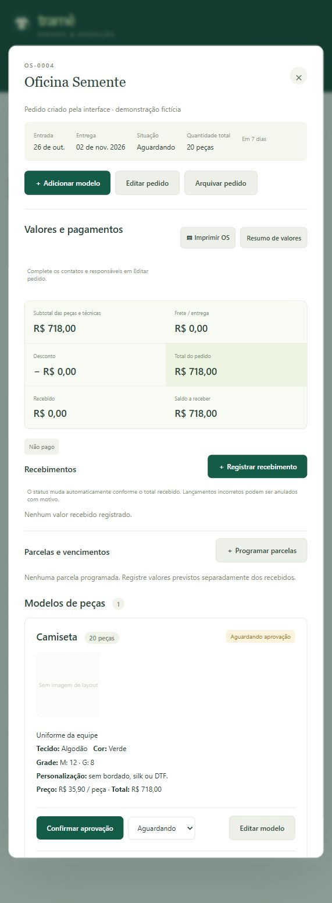

<p align="center"></p>

# Tramê

**Do orçamento à entrega, cada peça tem seu caminho.**

O Tramê acompanha pedidos de confecção: cliente, modelos, grades, layouts, produção e recebimentos ficam no mesmo lugar. O projeto nasceu da rotina de trabalho com bordado e personalização de roupas.

Aplicação local em português, com servidor Python, SQLite e interface em HTML, CSS e JavaScript. Cada funcionário acessa com usuário e senha. O uso local não depende de serviços externos.

**Estado:** em desenvolvimento. As verificações automatizadas cobrem regras comerciais, autenticação e persistência. A avaliação na rotina de uma empresa continua pendente.

## O que dá para fazer

- Preparar orçamentos e convertê-los em ordens de serviço.
- Separar modelos por tecido, cor, grade e técnicas: bordado, silk e DTF.
- Aprovar cada layout antes de iniciar a produção e preservar seu histórico.
- Distribuir etapas entre funcionários e acompanhar entregas parciais.
- Reservar materiais e registrar movimentações de estoque.
- Controlar parcelas e recebimentos, sem processar transações bancárias.
- Imprimir orçamento e ordem de serviço pelo navegador.
- Criar acessos de administrador e funcionário, com registro de ações.

## Executar no computador

Requisitos: **Python 3.12 ou superior** e um navegador atual. A edição local usa somente a biblioteca padrão do Python; não precisa de `pip install`.

No Windows, dê dois cliques em **Abrir Trame.cmd**. Também é possível abrir um terminal na pasta e executar:

```sh
python iniciar.py
```

O programa abre `http://127.0.0.1:18743`. Na primeira execução, use a chave criada em `dados/chave-primeiro-acesso.txt` para cadastrar o administrador. Não existe usuário ou senha padrão. A chave perde a utilidade depois da configuração inicial.

Mantenha o terminal aberto durante o uso. Para encerrar, pressione **Ctrl+C** nele. Fechar a aba do navegador não encerra o servidor.

Para iniciar sem abrir o navegador:

```sh
python iniciar.py --sem-navegador
```

O iniciador desta edição mantém o acesso restrito ao próprio computador. Banco de dados, contas e arquivos locais não fazem parte do repositório.

## Um pedido, passo a passo

1. Cadastre o cliente e monte um orçamento com um ou mais modelos.
2. Informe as quantidades por tamanho e os valores de cada técnica.
3. Converta o orçamento aprovado em uma OS.
4. Anexe o layout e registre a aprovação de cada modelo.
5. Distribua as etapas de produção e acompanhe o andamento.
6. Registre recebimentos e entregas conforme acontecerem.

Trocar um layout exige uma nova aprovação. Valores monetários são armazenados em centavos inteiros, evitando arredondamentos de ponto flutuante nos cálculos de preço.

## Verificar o projeto

Para a suíte completa, instale as dependências de desenvolvimento em um ambiente virtual. **Node.js 22 ou superior** executa os testes JavaScript, sem pacotes npm.

```sh
python -m venv .venv
# Windows: .venv\Scripts\activate
# Linux/macOS: source .venv/bin/activate
python -m pip install -r requirements-dev.txt
npm ci --ignore-scripts
python scripts/verificar.py
npm run format:check
```

Os testes usam bancos temporários. O verificador confere também a sintaxe JavaScript e a lista de arquivos preparados para publicação. O GitHub Actions executa a mesma verificação em Windows e Linux.

## Documentação

- [Arquitetura e regras de negócio](docs/ARQUITETURA.md)
- [Instalação, atualização e backup](docs/OPERACAO.md)
- [Como contribuir](CONTRIBUTING.md)
- [Cuidados com dados e segurança](SECURITY.md)
- [Notas desta preparação](docs/ENTREGA.md)
- [Resultados e limites da validação](docs/VALIDACAO.md)

## Telas

As capturas usam somente clientes e pedidos fictícios, em uma base separada.

<p>
  <a href="docs/imagens/painel.png"></a>
  <a href="docs/imagens/pedido.png"></a>
</p>

## Autoria e distribuição

Projeto de Gabriel, desenvolvido a partir de sua experiência na confecção. O módulo de QR Code possui licença MIT e créditos preservados em [vendor](vendor/LEIA-ME.md).

O código do Tramê é disponibilizado para consulta e avaliação de portfólio. Ainda não foi definida uma licença geral de redistribuição ou uso comercial. Consulte os [avisos de terceiros](AVISOS-DE-TERCEIROS.txt) antes de redistribuir dependências.
